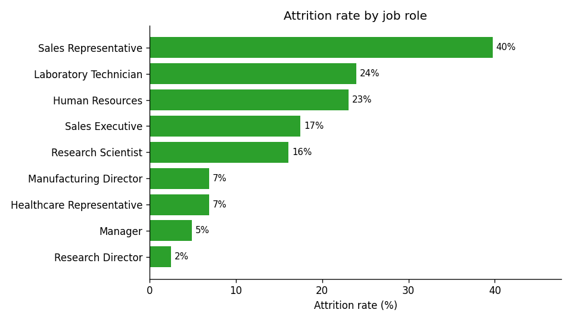
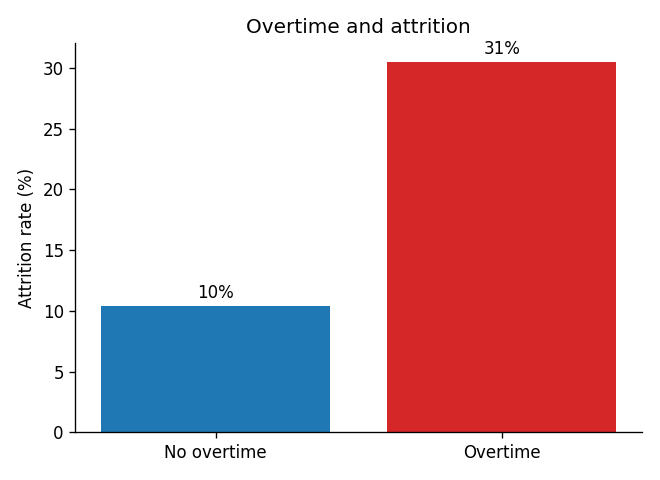
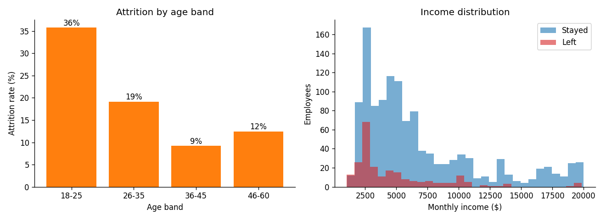
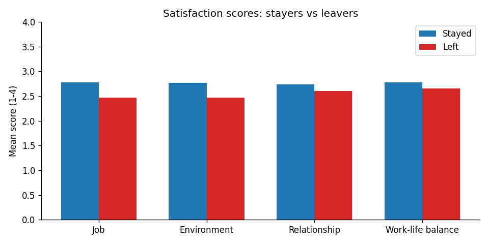

# HR Employee Attrition Analysis (Python, pandas, matplotlib)

A practice data-analysis project on the public IBM HR Analytics Employee Attrition dataset: **1,470 employees**, overall attrition rate **16.1%**. No client data; the dataset is public and linked below.

## Overview

Explored where attrition concentrates and what separates leavers from stayers: job role, overtime, age band, income and satisfaction scores.

## Tech

- Python (pandas)
- matplotlib

## Key findings

- **Sales Representatives attrite at 39.8%**, the highest of any role; Research Directors are lowest at 2.5%
- **Overtime employees attrite at 30.5%** vs 10.4% for non-overtime
- The youngest band (18-25) attrites at **35.8%**, roughly double the next band
- Median monthly income of leavers is **$3,202** vs **$5,204** for stayers
- Leavers score lower on job, environment and work-life-balance satisfaction

## Charts






## Dataset

- [IBM HR Analytics Employee Attrition & Performance sample](https://github.com/IBM/employee-attrition-aif360) (public)

## Run it

```bash
pip install pandas matplotlib
python3 analysis.py
```

Charts are written to `charts/`.

## Links

- Portfolio: [faresfolio-brehkes7.manus.space](https://faresfolio-brehkes7.manus.space)
- LinkedIn: [fares-mostafa-8812a4387](https://www.linkedin.com/in/fares-mostafa-8812a4387)
